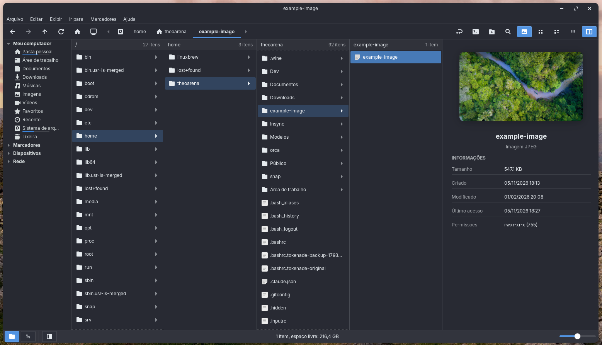
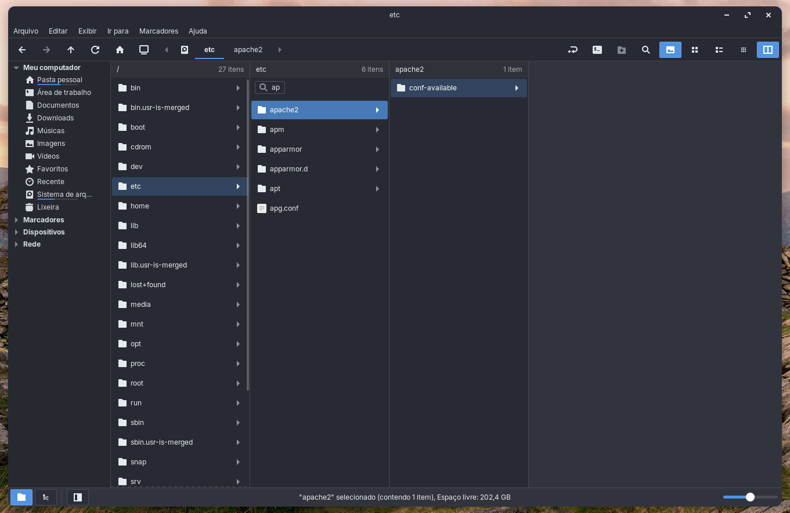

# Miller Columns for Nemo

A sleek Nemo extension bringing Miller columns to your active window, packed with instant file previews, in-column search, and top-tier responsiveness.

The view runs in-process through GTK 3 and nemo-python.



## Install

From this repository:

```bash
./install.sh
```

The script installs Nemo, nemo-python, and the GTK 3 introspection
packages with apt when they are missing. It symlinks
`nemo_miller_columns.py` into
`~/.local/share/nemo-python/extensions` and quits Nemo so the extension
reloads. Open Nemo again after it exits.

If you already have these packages installed use:

```bash
./install.sh --skip-deps
```

## Uninstall

```bash
./install.sh --uninstall
```

This removes the extension symlink. Settings already stored by Nemo stay in place.

## Features

### Turn the view on

Use the toolbar button or press Ctrl+4.

### Search

Type in a column to filter files and folders. Matching ignores case.



### Folder preference

Each folder can remember this view. The extension follows Nemo's
`ignore-view-metadata` and `inherit-folder-viewer` preferences in
`org.nemo.preferences`. When view metadata is ignored, the toolbar choice
applies to the window and is not written onto the folder.

### Language

The interface default language is English.
New languages can be added in [`translations/`](translations/).


[](https://ko-fi.com/Q2O42A6NTE)